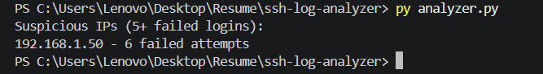

# SSH Log Analyzer

A Python tool that parses SSH authentication logs and detects possible brute-force attacks by flagging IPs with 5 or more failed login attempts.

## Usage
python analyzer.py

## Sample Output

## How it works
- Reads auth.log line by line
- Uses a regex to extract source IPs from "Failed password" entries
- Counts attempts per IP and reports those above the threshold

## Enhancements
- GeoIP lookup for each suspicious IP using the ip-api.com API
- CSV report export for easy sharing with a SOC team

## Known limitation
Private/internal IPs (e.g. 192.168.x.x) will not resolve to a real location.

## Note
Includes a sample log for demonstration.